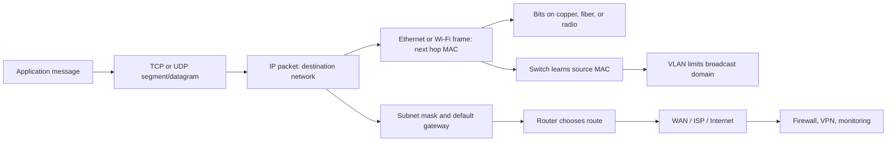

# COMP504 knowledge base

This is a navigation map for the original course files under `../course-materials/sources/`. The [course-materials catalogue](../course-materials/README.md) links to every relocated original. The chapter slides are the main course view; the Cisco modules and Packet Tracer activities add protocol and command detail. Transcript text is useful for emphasis but contains speech-recognition errors, so verify exact terms against slides and modules.

Quick source links: [final revision deck](<../course-materials/sources/exam/2026 COMP504 _FINAL EXAM Revision.pptx>), [network and transport slides part 2](<../course-materials/sources/slides/chapters/ch05 Transport-Network Part 2-4-1 (1).pptx>), [wired and wireless LAN slides](<../course-materials/sources/slides/chapters/ch07 Wired and Wireless LANs-1-1.pptx>), [VLSM worked example](<../course-materials/sources/labs/vlsm/Example-Design and Implement a VLSM Addressing Scheme.docx>), and [final practice lab instructions](<../course-materials/sources/labs/final-practice/Packet Tracer Final Lab-1.docx>).

| Course area | Best starting sources | Apply it in |
| --- | --- | --- |
| Week 1: networks, OSI/TCP-IP, encapsulation | [`Week 1 part 1.md`](<../course-materials/sources/transcripts/Week 1 part 1.md>), [`Week 1 part 2.md`](<../course-materials/sources/transcripts/Week 1 part 2.md>), [`ch01 Intro-5.pptx`](<../course-materials/sources/slides/chapters/ch01 Intro-5.pptx>), [`Module_1_Intro_Internet.pdf`](<../course-materials/sources/cisco-modules/Module_1_Intro_Internet.pdf>), [`Module_3_NetworkProtocols.pdf`](<../course-materials/sources/cisco-modules/Module_3_NetworkProtocols.pdf>) | [`1.5.7 Packet Tracer - Network Representation.pka`](<../course-materials/sources/labs/packet-tracer-files/1.5.7 Packet Tracer - Network Representation.pka>); [`Packet Tracer-Investigating the TCP-IP and OSI Models-1.docx`](<../course-materials/sources/labs/instructions/Packet Tracer-Investigating the TCP-IP and OSI Models-1.docx>) |
| Week 2: physical layer, media, duplex, binary | [`Week 2 part 1.md`](<../course-materials/sources/transcripts/Week 2 part 1.md>), [`Week 2 part 2.md`](<../course-materials/sources/transcripts/Week 2 part 2.md>), [`ch03 Physical layer-1.pptx`](<../course-materials/sources/slides/chapters/ch03 Physical layer-1.pptx>), [`Number system.pptx`](<../course-materials/sources/slides/supporting/Number system.pptx>), [`Module_4_Physical_Layer.pdf`](<../course-materials/sources/cisco-modules/Module_4_Physical_Layer.pdf>), [`Module_5_NumberSystems.pdf`](<../course-materials/sources/cisco-modules/Module_5_NumberSystems.pdf>) | [`Lab1 Notes - Ethernet Cable configuration.pptx`](<../course-materials/sources/slides/supporting/Lab1 Notes - Ethernet Cable configuration.pptx>) |
| Week 3: data link, framing, errors, MAC | [`Week 3 part 1.md`](<../course-materials/sources/transcripts/Week 3 part 1.md>), [`Week 3 part 2.md`](<../course-materials/sources/transcripts/Week 3 part 2.md>), [`ch04 Link layer-2.pptx`](<../course-materials/sources/slides/chapters/ch04 Link layer-2.pptx>), [`Module_6_DataLink_Layer.pdf`](<../course-materials/sources/cisco-modules/Module_6_DataLink_Layer.pdf>), [`Module_7_EthernetSwitching.pdf`](<../course-materials/sources/cisco-modules/Module_7_EthernetSwitching.pdf>) | [`5.3.1.3 Packet Tracer - Identify MAC and IP Addresses.pka`](<../course-materials/sources/labs/packet-tracer-files/5.3.1.3 Packet Tracer - Identify MAC and IP Addresses.pka>) |
| Weeks 4–5 and missing Week 9 recording: transport, IP, routing, subnetting, ICMP | [`Week 4 part 1.md`](<../course-materials/sources/transcripts/Week 4 part 1.md>), [`Week 4 part 2.md`](<../course-materials/sources/transcripts/Week 4 part 2.md>), [`Week 5 part 1.md`](<../course-materials/sources/transcripts/Week 5 part 1.md>), [`Week 5 part 2.md`](<../course-materials/sources/transcripts/Week 5 part 2.md>), both `ch05 Transport-Network` decks, [`Default Gateway.pptx`](<../course-materials/sources/slides/supporting/Default Gateway.pptx>), [`IP subnetting-1.pptx`](<../course-materials/sources/slides/supporting/IP subnetting-1.pptx>), Cisco Modules 8–14 | [`10.3.5 Packet Tracer - Troubleshoot Default Gateway Issues.pka`](<../course-materials/sources/labs/packet-tracer-files/10.3.5 Packet Tracer - Troubleshoot Default Gateway Issues.pka>); both VLSM activities |
| Week 6: Ethernet and WLAN | [`Week 6 part 1.md`](<../course-materials/sources/transcripts/Week 6 part 1.md>), [`Week 6 part 2.md`](<../course-materials/sources/transcripts/Week 6 part 2.md>), [`ch07 Wired and Wireless LANs-1-1.pptx`](<../course-materials/sources/slides/chapters/ch07 Wired and Wireless LANs-1-1.pptx>), [`Module_7_EthernetSwitching.pdf`](<../course-materials/sources/cisco-modules/Module_7_EthernetSwitching.pdf>) | [`4.2.4.4 Packet Tracer - Connecting a Wired and Wireless LAN.pka`](<../course-materials/sources/labs/packet-tracer-files/4.2.4.4 Packet Tracer - Connecting a Wired and Wireless LAN.pka>) |
| Week 7: design and backbones | [`Week 7 part 1.md`](<../course-materials/sources/transcripts/Week 7 part 1.md>), [`Week 7 part 2.md`](<../course-materials/sources/transcripts/Week 7 part 2.md>), [`ch06 Network design-5.pptx`](<../course-materials/sources/slides/chapters/ch06 Network design-5.pptx>), [`ch08 Backbone network-1-1.pptx`](<../course-materials/sources/slides/chapters/ch08 Backbone network-1-1.pptx>) | VLAN design thought experiment in `LABS.md` |
| Week 8: Internet and management | [`Week 8 part 1.md`](<../course-materials/sources/transcripts/Week 8 part 1.md>), [`Week 8 part 2.md`](<../course-materials/sources/transcripts/Week 8 part 2.md>), [`ch10 Internet-2.pptx`](<../course-materials/sources/slides/chapters/ch10 Internet-2.pptx>), [`ch12 Network management-1.pptx`](<../course-materials/sources/slides/chapters/ch12 Network management-1.pptx>) | Internet access comparison and fault log in `LABS.md` |
| Week 10: WAN and applications | [`Week 10 part 1.md`](<../course-materials/sources/transcripts/Week 10 part 1.md>), [`Week 10 part 2.md`](<../course-materials/sources/transcripts/Week 10 part 2.md>), [`ch09 Wide area network-2.pptx`](<../course-materials/sources/slides/chapters/ch09 Wide area network-2.pptx>), [`ch02 Application layer-2.pptx`](<../course-materials/sources/slides/chapters/ch02 Application layer-2.pptx>), [`Module_15_Application_Layer.pdf`](<../course-materials/sources/cisco-modules/Module_15_Application_Layer.pdf>) | VPN/WAN scenario questions in `PRACTICE.md` |
| Week 11: security | [`Week 11 part 1.md`](<../course-materials/sources/transcripts/Week 11 part 1.md>), [`Week 11 part 2.md`](<../course-materials/sources/transcripts/Week 11 part 2.md>), [`ch11 Network security-1.pptx`](<../course-materials/sources/slides/chapters/ch11 Network security-1.pptx>), [`Module_16_Security_Threats.pdf`](<../course-materials/sources/cisco-modules/Module_16_Security_Threats.pdf>) | Security scenario questions in `PRACTICE.md` |
| Week 12: revision | [`Week 12 .md`](<../course-materials/sources/transcripts/Week 12 .md>), [`2026 COMP504 _FINAL EXAM Revision.pptx`](<../course-materials/sources/exam/2026 COMP504 _FINAL EXAM Revision.pptx>) | All practice questions; [`Packet Tracer Final Lab.pka`](<../course-materials/sources/labs/final-practice/Packet Tracer Final Lab.pka>) |

## Connected ideas

**Packet journey:** The application creates data. TCP or UDP handles host-to-host transport. IP identifies source and destination hosts across networks. Each hop wraps the IP packet in a fresh link-layer frame addressed to the next hop. A switch forwards within a LAN using MAC addresses; a router forwards between IP networks using its routing table. The physical medium carries bits.

**Most useful cross-links:** subnet mask → same-network decision → ARP for destination or default gateway → switch forwarding → router route → new frame → destination. A failed ping can result from any link in this chain. The lab path makes you test each link.

## Source cautions and corrections

- The revision slide calls ICMP an “interior routing protocol.” That wording is incorrect. **ICMP carries control/error messages**; `ping` uses ICMP Echo Request and Echo Reply. Routing protocols exchange route information, which is a different job. See [`Module_13_ICMP.pdf`](<../course-materials/sources/cisco-modules/Module_13_ICMP.pdf>).
- A course slide says a switch without VLANs sends all unicast to all devices. A learned destination unicast is normally forwarded only to its learned port; **unknown unicast** and broadcast can be flooded within the VLAN. See [`Module_7_EthernetSwitching.pdf`](<../course-materials/sources/cisco-modules/Module_7_EthernetSwitching.pdf>).
- Some slides call older WLAN/security technologies “current.” Learn their role for the course, but do not treat those age labels as current CCNA guidance. In particular, WEP is obsolete and insecure; SSL is a legacy term, while TLS is the modern protocol family.
- The formula `2^host_bits - 2` is the standard rule used in these exercises for ordinary IPv4 subnets, including `/30` WAN links. The practice labs use that rule.
- [`Example-Design and Implement a VLSM Addressing Scheme-1.docx`](<../course-materials/sources/labs/vlsm/Example-Design and Implement a VLSM Addressing Scheme-1.docx>) and the version without `-1` have identical extracted text. The two `VLSM_subnetting_Block-method` PDFs appear to be duplicate handouts. Keep originals as supplied; use one copy when studying.

## What is missing here

The folder has no Week 9 transcript and no Canvas quizzes. The reviewer covers topics named in the revision deck, but it cannot predict the exact final questions. Use the source slides and Canvas quizzes to resolve any question where course wording matters.
